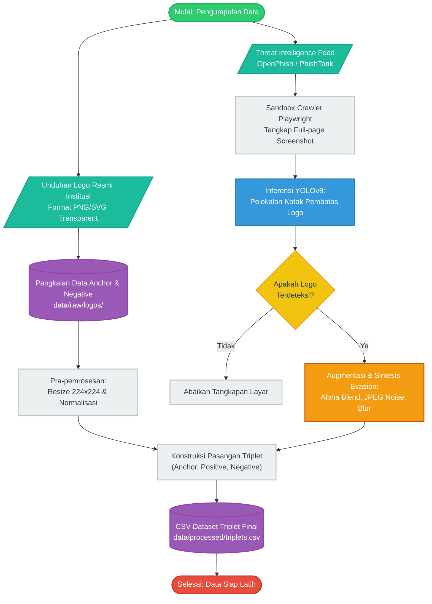
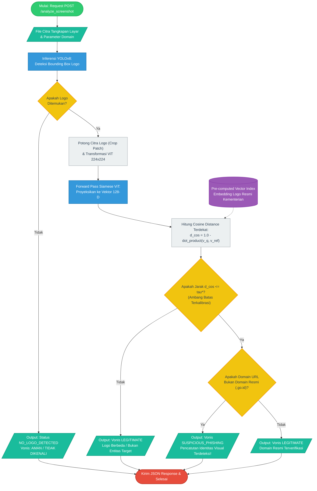

# SPESIFIKASI DAN KODE DIAGRAM ALIR SKRIPSI (DRAW.IO & MERMAID)

Tiga diagram alir modular ini dirancang sesuai standar visualisasi metodologi akademik STIS. Setiap diagram menggunakan notasi standar flowchart (ANSI/ISO) dan dapat langsung diimpor ke **Draw.io** melalui menu:
`Arrange` ➔ `Insert` ➔ `Advanced` ➔ `Mermaid`.

---

## 1. Diagram 1: Alur Pengumpulan dan Pra-pemrosesan Data (Data Pipeline)

Diagram ini mengilustrasikan pembentukan dataset dari dua sumber (resmi dan phishing liar), pelokalan YOLOv8, augmentasi sintesis, hingga terkonstruksi menjadi *dataset triplet*.



---

## 2. Diagram 2: Pelatihan Adversarial Siamese ViT (Model Pipeline)

Diagram ini mengilustrasikan siklus optimisasi *Min-Max*: penyerang PGD membangkitkan gangguan pada citra *positive* secara *on-the-fly* (*Inner Maximization*), diikuti oleh pembaruan bobot ViT (*Outer Minimization*) dan pencatatan metrik ganda ke MLflow.

```mermaid
flowchart TD
    %% Styling Classes
    classDef terminal fill:#2ecc71,stroke:#27ae60,stroke-width:2px,color:#fff;
    classDef endTerminal fill:#e74c3c,stroke:#c0392b,stroke-width:2px,color:#fff;
    classDef process fill:#ecf0f1,stroke:#bdc3c7,stroke-width:2px,color:#2c3e50;
    classDef modelDL fill:#3498db,stroke:#2980b9,stroke-width:2px,color:#fff;
    classDef dataManip fill:#e67e22,stroke:#d35400,stroke-width:2px,color:#fff;
    classDef database fill:#9b59b6,stroke:#8e44ad,stroke-width:2px,color:#fff;
    classDef decision fill:#f1c40f,stroke:#f39c12,stroke-width:2px,color:#2c3e50;

    StartTrain([Mulai Pelatihan Model]):::terminal
    StartTrain --> LoadData[(Muat Triplet Dataset<br/>data/processed/triplets.csv)]:::database
    LoadData --> Batch["Ambil 1 Batch Triplet<br/>(Anchor, Positive, Negative)"]:::process

    %% Inner Maximization (PGD Attack)
    subgraph InnerLoop ["Inner Maximization: On-the-fly Attack"]
        Batch --> PGD["Sub-proses PGD Attack:<br/>delta = alpha * sign(grad_loss)<br/>Hasilkan Positive Adversarial"]:::dataManip
    end

    %% Outer Minimization (Model Update)
    subgraph OuterLoop ["Outer Minimization: Weight Update"]
        PGD --> ForwardViT["Forward Pass Siamese ViT:<br/>Ekstraksi Embedding 128-D<br/>(Norm L2 pada Hipersfer Satuan)"]:::modelDL
        ForwardViT --> Loss["Hitung Triplet Margin Loss:<br/>L = max(0, d(A,P_adv) - d(A,N) + m)"]:::process
        Loss --> Backward["Backpropagation AdamW &<br/>Gradient Clipping (max=1.0)"]:::process
    end

    Backward --> CheckBatch{"Apakah Epoch<br/>Selesai?"}:::decision
    CheckBatch -- Tidak --> Batch
    CheckBatch -- Ya --> ValHoldout["Evaluasi Dual Validasi Hold-out:<br/>Hitung Std PR-AUC & Robust PR-AUC<br/>Catat ke MLflow Tracker"]:::process

    ValHoldout --> CheckPRAUC{"Apakah Nilai<br/>Robust PR-AUC<br/>Meningkat?"}:::decision
    CheckPRAUC -- Ya --> SaveModel[(Simpan Bobot Terbaik:<br/>models/best_siamese_vit.pt)]:::database
    CheckPRAUC -- Tidak --> CheckEpoch{"Apakah Batas<br/>Max Epoch<br/>Tercapai?"}:::decision
    SaveModel --> CheckEpoch

    CheckEpoch -- Tidak --> Batch
    CheckEpoch -- Ya --> EndTrain([Selesai Pelatihan]):::endTerminal
```



---

## 3. Diagram 3: Arsitektur Implementasi Sistem (Inference / API Pipeline)

Diagram ini mengilustrasikan alur pemanggilan inferensi pada *microservice* FastAPI (simulasi integrasi sistem aduan Komdigi / CSIRT), pemanfaatan *pre-computed vector index*, dan pengujian ambang batas $\tau^*$.



---

## Petunjuk Praktis Penyisipan ke Draw.io / Naskah Skripsi

1. **Salin Kode Mermaid:** Salin blok kode di dalam tanda ```mermaid di atas.
2. **Impor ke Draw.io:**
   * Buka [draw.io](https://app.diagrams.net/).
   * Klik menu atas: **Arrange ➔ Insert ➔ Advanced ➔ Mermaid**.
   * Tempelkan kode dan klik **Insert**.
   * Draw.io akan secara otomatis menggambar diagram dengan bentuk geometris yang sesuai (tabung, jajar genjang, belah ketupat, dan oval).
3. **Ekspor Gambar:** Ekspor diagram dalam format **PDF Vector** atau **PNG 300 DPI Transparent** agar garis dan teks tidak pecah saat dicetak ke naskah skripsi fisik.
